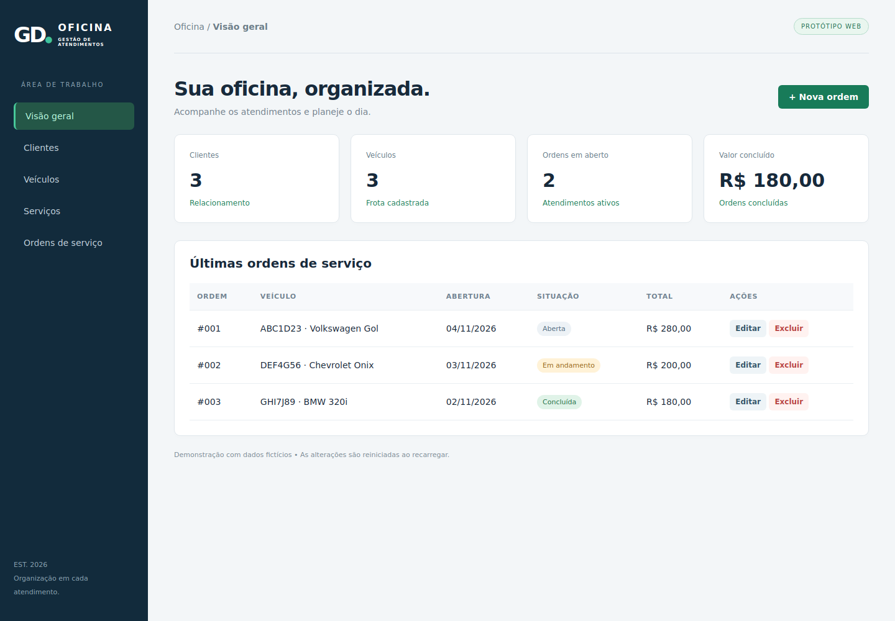
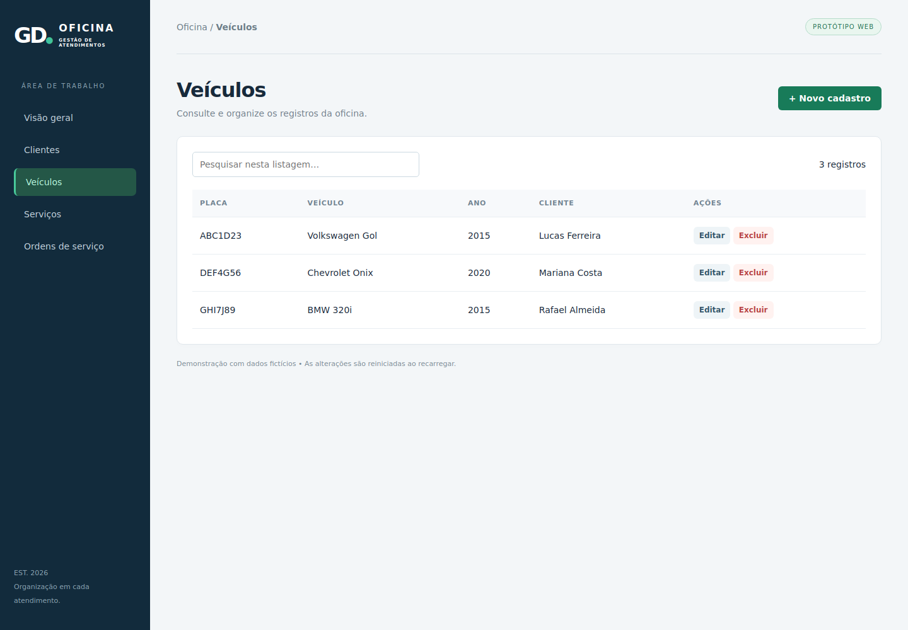
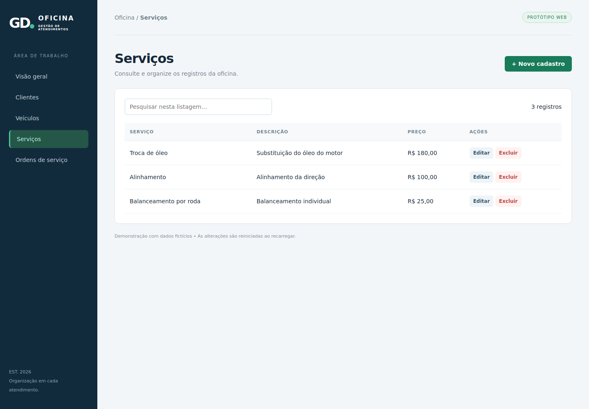
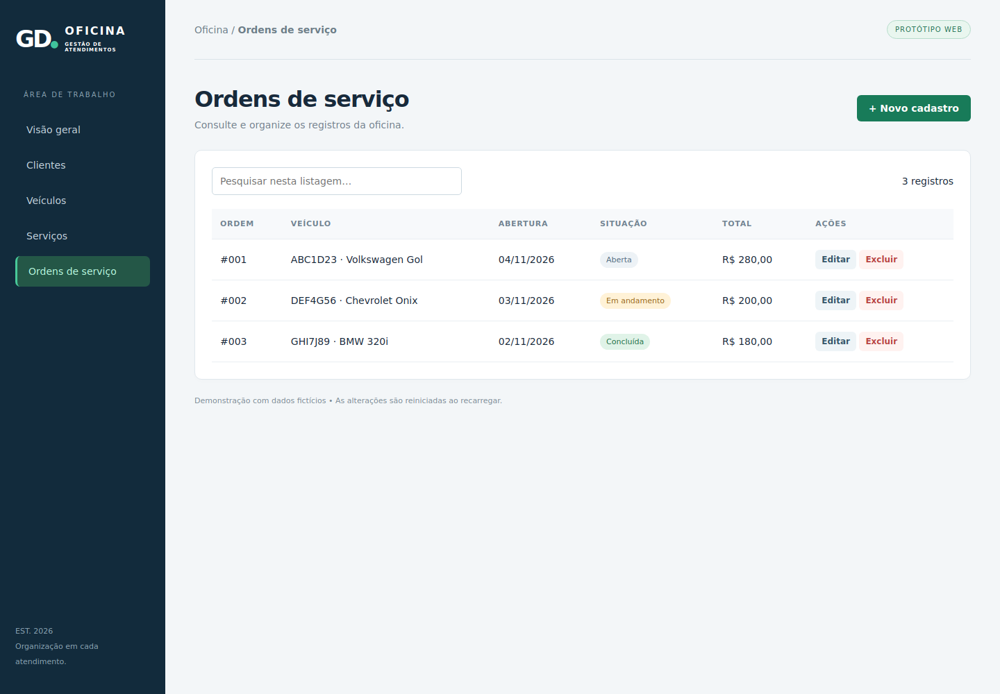
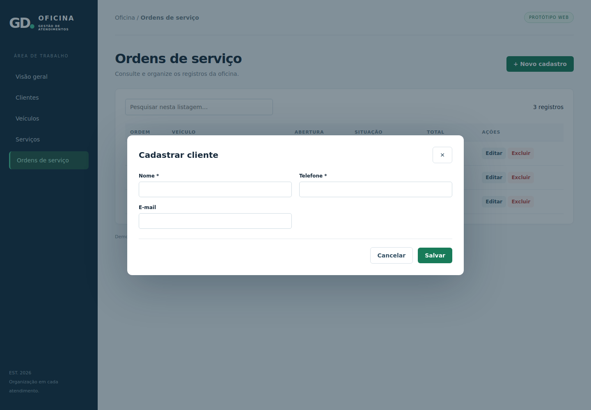
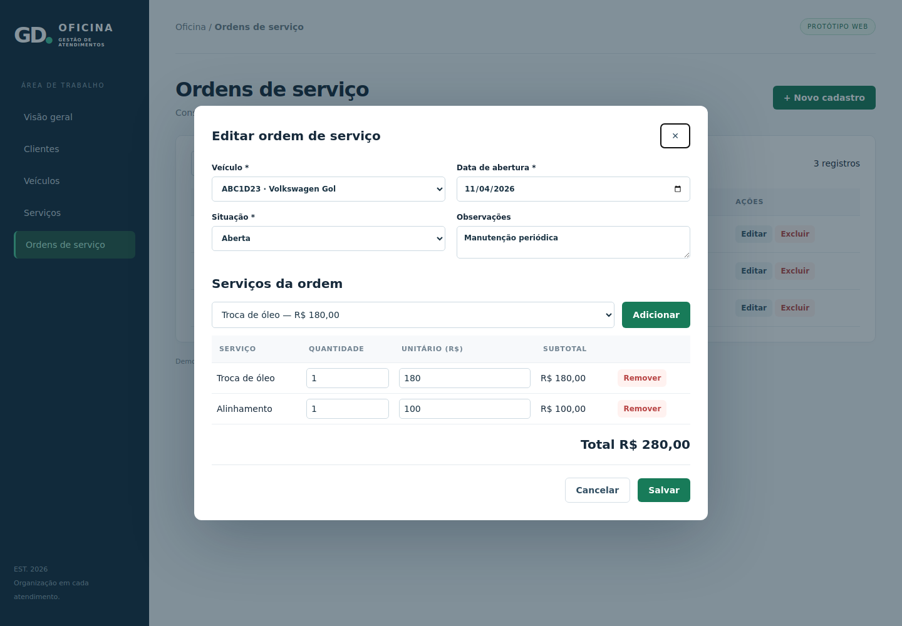
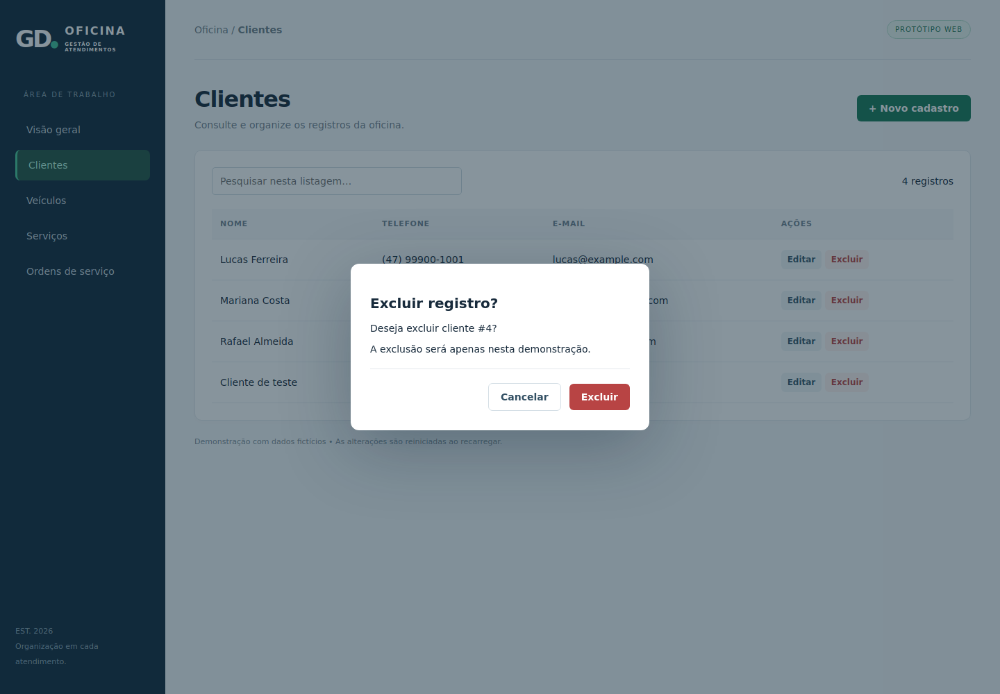
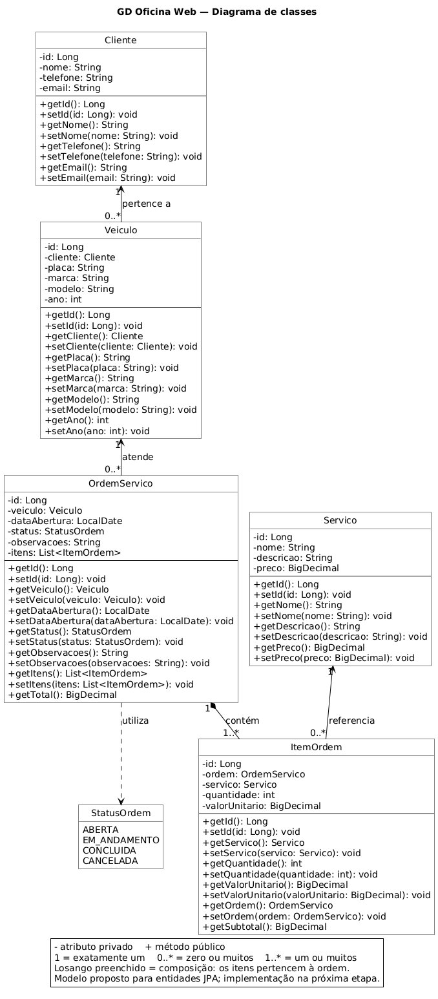
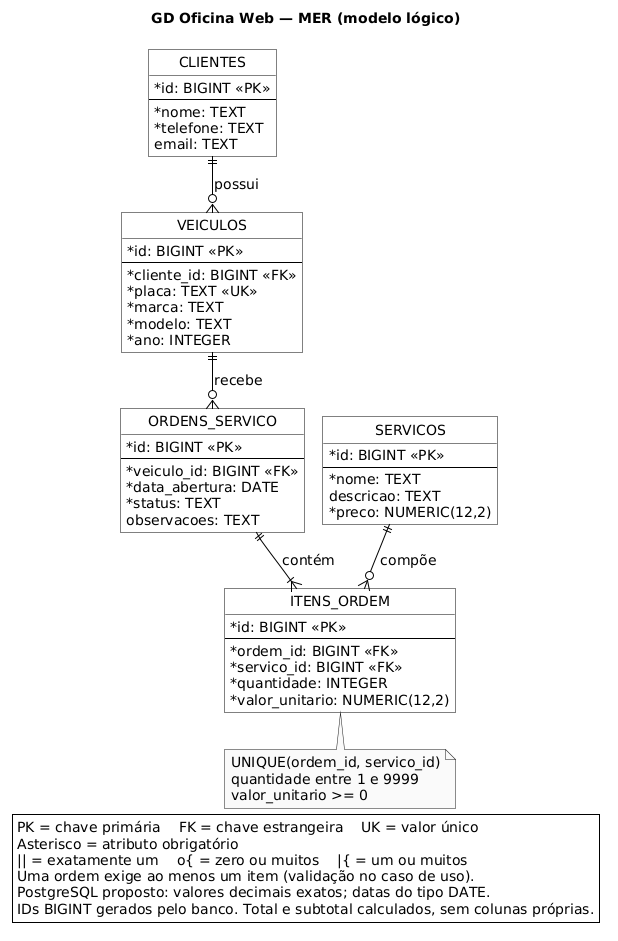

# GD Oficina Web

Tema: sistema web para gerenciamento de uma oficina mecânica.

A proposta é organizar os clientes, seus veículos, o catálogo de serviços e as ordens de serviço da oficina. O público-alvo são pequenas oficinas que precisam acompanhar os atendimentos e os serviços realizados em cada veículo.

### Telas do sistema

## Diagrama de classes das entidades

## MER — modelo lógico relacional

## Exemplo de como usar o sistema
1. Em Clientes, clique em Novo, preencha os dados e salve.
2. Em Veículos, selecione o cliente e informe placa, marca, modelo e ano.
3. Em Serviços, cadastre o nome e o preço de referência. Use valores como 120,00 ou 1.234,56.
4. Em Ordens de serviço, selecione o veículo, adicione um ou mais serviços e salve.
5. Para alterar um item da ordem, selecione a linha, ajuste os campos e clique em Alterar selecionado. Depois, salve a ordem.
6. Para editar um cadastro, selecione a linha e clique em Editar, ou dê dois cliques na linha.
7. Use Pesquisar para filtrar e Limpar para voltar à lista completa. O filtro aceita nomes com ou sem acentos.

A situação da ordem pode ser Aberta, Em andamento, Concluída ou Cancelada. Cancelar um formulário descarta as mudanças ainda não salvas. Os indicadores são atualizados ao retornar ao Início. O valor concluído é a soma das ordens concluídas, e não um controle de pagamentos.

